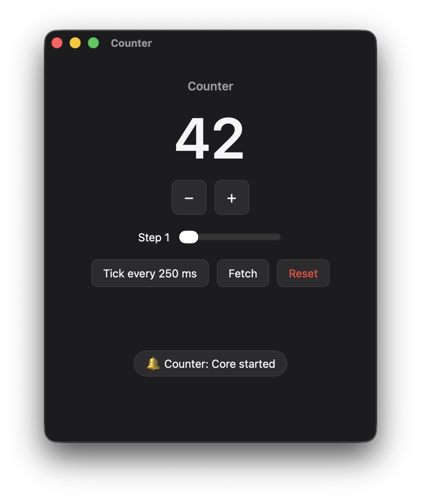

# Carapace

Share a Rust app core between SwiftUI, Tauri and Node shells. Carapace is for
apps that need native interfaces without duplicating state and business logic.
The core handles actions, timers and background work; each shell renders JSON
snapshots and handles platform events through a twelve-function C ABI.

Swift and TypeScript bindings are generated from JSON Schema. A schema
fingerprint check catches stale bindings when the store connects.

<p>
  
  
</p>

## Privacy

Carapace sends nothing over the network while your app runs. The core, Swift and
TypeScript stores, Tauri plugin and example shells make no HTTP requests, open no
sockets and ship no telemetry, analytics, crash reporter, beacon or update check.
The example windows load only local CSS, scripts and images; there are no remote
fonts or CDNs. There are no user or machine identifiers in the code.

`cargo carapace` runs local build tools only: it does not phone home. The `cargo`,
`npm` and other tools it invokes are given telemetry opt-outs; `cargo` itself may
still download a missing crate. The install commands below download the client
from GitHub or dependencies from npm because you run them.

The libraries keep state, events and faults in memory only; fault history is
capped at the newest 50 messages. Nothing is written to a user data directory.
`cargo carapace gen` writes generated Swift/TypeScript bindings to `./generated`
(or `--out`), and `cargo carapace build apple` writes an xcframework under
`./apple` (or `--out`); on Unix, directories it creates are `0700` and files are
`0600`. Quit the app to discard in-memory data; delete those output directories
to remove generated files. There is no other stored data to clear.

Carapace configures no third-party service. If you write a core or shell that
calls one, that service receives whatever your code sends it.

## Install

Install the prebuilt TypeScript client with npm:

```sh
npm i https://github.com/michael-berardi/carapace/releases/download/v0.1.2/carapace-client-0.1.2.tgz
```

This is the client library, not the Rust core or CLI.

### From source

Install the CLI with Rust:

```sh
cargo install --git https://github.com/michael-berardi/carapace cargo-carapace --locked
cargo carapace doctor
```

The CLI generates bindings and packages Apple libraries. Apple packaging needs
macOS, Xcode and the Rust targets for each requested architecture.

Try generation with the included Counter core:

```sh
git clone https://github.com/michael-berardi/carapace
cd carapace
cargo carapace gen all -p counter-core --out generated
```

This writes `Counter.swift` and `Counter.ts`. For your own core, implement
`carapace::App`, export it with `carapace::export!`, and build it as a `cdylib`
(and a `staticlib` for Apple packaging).
[Getting started](docs/getting-started.md) covers the core, dependencies,
Swift package setup, Tauri permissions and complete shell examples.

## Shells

| Shell | Support |
|---|---|
| SwiftUI, macOS 13+ | `CarapaceKit` observable store and `CarapaceFFI` backend; unit and real-core tests. |
| SwiftUI, iOS 16+ | Declared Swift package target; `build apple --ios` packages device and simulator slices. iOS compilation is not covered by the test script. |
| Tauri 2 | Rust plugin and TypeScript client, with React hooks. Example builds on macOS; Windows and Linux are unverified. |
| Node / Electron main process | C ABI transport using `koffi`, tested in Node; Electron is unverified. |
| Python | [`Tests/abi/test_abi.py`](Tests/abi/test_abi.py) exercises every ABI function. |
| Other C callers | Use the [C header](Sources/CCarapace/include/carapace.h). No other generators are included. |

Swift's `sendSync` applies state before returning; call it **inside**
`withAnimation` when animation is needed. It does not start an animation itself.
Pure queries run without changing state. Events are buffered with limits;
Tauri page reloads can lose events. See [architecture](docs/architecture.md)
for delivery guarantees, ABI rules, schema limits and the snapshot benchmark.

## Develop

On macOS with Xcode, Rust, Node 20+ and Python 3:

```sh
cargo fmt --all --check
cargo clippy --workspace --all-targets -j 4
CARGO_BUILD_JOBS=4 scripts/test-all.sh
```

The script runs Rust, Python ABI, Swift and TypeScript tests, then builds both
Counter shells without launching them. Apple packaging also requires the
`aarch64-apple-darwin` and `x86_64-apple-darwin` Rust targets.

[Counter example](examples/counter) · [Choosing a shell](docs/choosing-a-shell.md) ·
[Contributing](CONTRIBUTING.md) · [Security](SECURITY.md) ·
[Changelog](CHANGELOG.md) · [MIT](LICENSE)

---

Part of [Pareto Cybernetics](https://paretocybernetics.com/projects/carapace/): free, private, open-source tools for working with AI agents.
