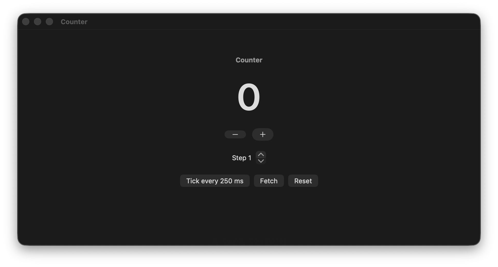

# Carapace

Share a Rust app core between SwiftUI, Tauri and Node shells. Carapace is for
apps that need native interfaces without duplicating state and business logic.
The core handles actions, timers and background work; each shell renders JSON
snapshots and handles platform events through a twelve-function C ABI.

Swift and TypeScript bindings are generated from JSON Schema. A schema
fingerprint check catches stale bindings when the store connects.

<p>
  
  
</p>

## Install

Install the prebuilt TypeScript client with npm:

```sh
npm i https://github.com/michael-berardi/carapace/releases/download/v0.2.0/carapace-client-0.2.0.tgz
```

This is the client library, not the Rust core or CLI.

### From source

Install the CLI with Rust:

```sh
cargo install --git https://github.com/michael-berardi/carapace cargo-carapace --locked
cargo carapace doctor
```

The CLI generates bindings and packages Apple libraries. Apple packaging needs
macOS, Xcode and the Rust targets for each requested architecture.

Try generation with the included Counter core:

```sh
git clone https://github.com/michael-berardi/carapace
cd carapace
cargo carapace gen all -p counter-core --out generated
```

This writes `Counter.swift` and `Counter.ts`. For your own core, implement
`carapace::App`, export it with `carapace::export!`, and build it as a `cdylib`
(and a `staticlib` for Apple packaging).
[Getting started](docs/getting-started.md) covers the core, dependencies,
Swift package setup, Tauri permissions and complete shell examples.

## Updates

After a command, `cargo carapace` says when a newer release exists; `cargo carapace update`
installs it with Cargo. Automatic installs stay off until you turn them on. See [Updates](docs/updates.md).

## Privacy

No telemetry, analytics or identifiers. The Rust crates, Swift package and npm client make no network requests.
`cargo carapace` checks GitHub's public latest-release record at most once a day, anonymously, on a terminal only.
Turn the check off with `CARAPACE_NO_UPDATE_CHECK=1` or `cargo carapace update --checks off`.
The CLI keeps its update state (and the opt-in auto-update log) in your cache folder; `cargo carapace update --clean` removes them.
Details: [PRIVACY.md](PRIVACY.md).

## Shells

| Shell | Support |
|---|---|
| SwiftUI, macOS 13+ | `CarapaceKit` observable store and `CarapaceFFI` backend; unit and real-core tests. |
| SwiftUI, iOS 16+ | Declared Swift package target; `build apple --ios` packages device and simulator slices. iOS compilation is not covered by the test script. |
| Tauri 2 | Rust plugin and TypeScript client, with React hooks. Example builds on macOS; Windows and Linux are unverified. |
| Node / Electron main process | C ABI transport using `koffi`, tested in Node; Electron is unverified. |
| Python | [`Tests/abi/test_abi.py`](Tests/abi/test_abi.py) exercises every ABI function. |
| Other C callers | Use the [C header](Sources/CCarapace/include/carapace.h). No other generators are included. |

Swift's `sendSync` applies state before returning; call it **inside**
`withAnimation` when animation is needed. It does not start an animation itself.
Pure queries run without changing state. Events are buffered with limits;
Tauri page reloads can lose events. See [architecture](docs/architecture.md)
for delivery guarantees, ABI rules, schema limits and the snapshot benchmark.

## Develop

On macOS with Xcode, Rust, Node 20+ and Python 3:

```sh
cargo fmt --all --check
cargo clippy --workspace --all-targets -j 4
CARGO_BUILD_JOBS=4 scripts/test-all.sh
```

The script runs Rust, Python ABI, Swift and TypeScript tests, then builds both
Counter shells without launching them. Apple packaging also requires the
`aarch64-apple-darwin` and `x86_64-apple-darwin` Rust targets.

[Counter example](examples/counter) · [Choosing a shell](docs/choosing-a-shell.md) ·
[Contributing](CONTRIBUTING.md) · [Security](SECURITY.md) ·
[Changelog](CHANGELOG.md) · [MIT](LICENSE)

---

Part of [Pareto Cybernetics](https://paretocybernetics.com/projects/carapace/): free, private, open-source tools for working with AI agents.
